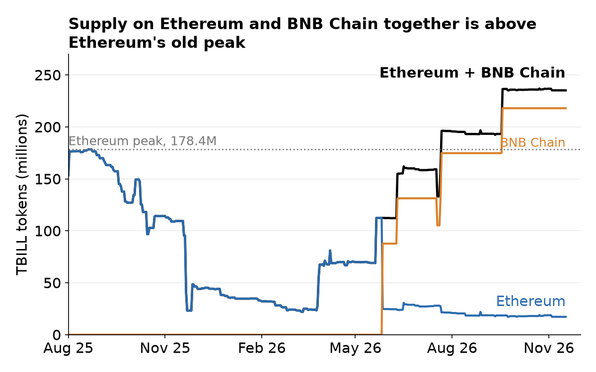
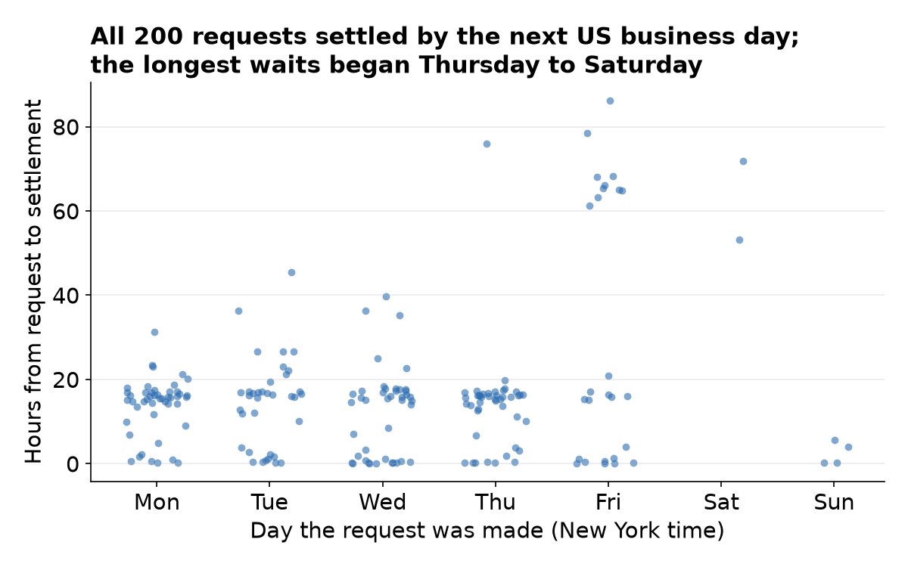
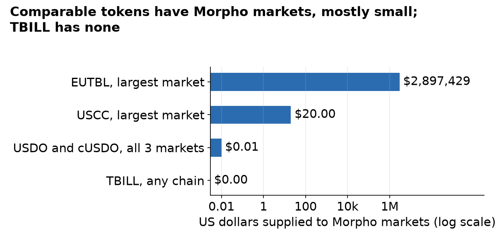

# What it would take for OpenEden's TBILL to be collateral on Morpho

On 16 November 2026 the issuer's approved list does not include Morpho's lending contract or any of the 8 busiest Morpho liquidators I tested. The list is the first condition for a Morpho market and it is not the only one.

## Mechanism

TBILL is backed by short-dated US Treasury bills and issued by a fund registered in the British Virgin Islands. Its net asset value, posted on chain by the issuer, is 1.16 USDC per token. Redemptions go through a queue that an operator works in order; the documents say "Redemptions are typically processed on the next 1 U.S. business day."

Before every transfer the token contract checks that sender and receiver are on the issuer's approved list and not banned. A 3-of-4 multisig, a wallet that needs a set number of its signers to agree, controls the list and can remove or ban any address.

A Morpho market pairs one collateral token with one loan token. Depositing, withdrawing and seizing collateral are transfers into or out of Morpho's contract, so with a permissioned token, which restricts transfers to approved addresses, Morpho and every liquidator that receives seized collateral must be on the issuer's list.

## Data

Across Ethereum and BNB Chain, supply grew from about 69 million tokens on 18 May 2026 to about 235 million on 16 November 2026, above Ethereum's old peak. On Ethereum alone, supply is about 90% below its August 2025 peak. A burn of about 88 million tokens on Ethereum on 26 May 2026 matches a mint on BNB Chain to six decimals 9 minutes later. If that is a move between chains (an inference), a little more than half of Ethereum's net fall (54%) is a move and the rest is holders redeeming.

*Millions of TBILL tokens at midnight UTC. The dotted line is Ethereum's peak. The XRP Ledger, with 19 million tokens per rwa.xyz, is not shown.*

Since 1 December 2024, 218 requests have left the redemption queue. The 200 I could match to payouts followed the documents: typical wait about 16 hours, longest about 86. The slowest requests all began between Thursday and Saturday, with a weekend or a holiday in between, and counted in US business days all 200 settled by the next one. A further 12 requests from December 2024 have no matched payout and 6 were cancelled; the data does not show why.

*Each dot is one matched request: height is the wait, column is the weekday it was made in New York. The 12 unmatched and 6 cancelled requests are not shown.*

The record shows how the issuer has run the queue, not how much it could pay at once. The vault holds less than a dollar of USDC, and each of the last year's 120 payouts followed a USDC top-up from one of 14 senders, most of which I cannot identify. The instant route, `redeemIns`, reverted in simulation on the redemption contract's "Not asset holder" check, so instant capacity was not tested.

EUTBL (Spiko) and USCC (Superstate) have Morpho on their lists and have markets. The markets are small, with 0 liquidations on EUTBL and 1 on USCC between them. The chart also shows the issuer's USDO tokens, which need no list and have three small markets.

*A log scale: each gridline is a hundred times the one before it.*

## What it would take

First, the issuer's list would have to include Morpho's contract and at least three independent liquidators; three is my judgment. This is necessary and not sufficient. A listing can be withdrawn, a liquidator's only exit is the redemption queue, which one key can pause, and there is no exchange pool.

Second, a simulated instant redemption of $1 million succeeds, or the 90th percentile wait stays within two days for three months. Without that the pilot is half the size.

If both conditions held, I would cap a pilot at about $1 million and at most 1% of the lending vault's assets, sized as a loss taken in full. If the listing were withdrawn, collateral could not be withdrawn or seized, while repaying a loan would still work. One 4-of-5 multisig holds 6 role slots across the token's contracts, including the right to burn tokens from any wallet. One key can pause withdrawals.

## Not shown

Every reading is one moment. The issuer was not asked about the burn or the BNB Chain mints. On Ethereum there are 11 holders besides the vault and one holds over half, so a market there would have one or two borrowers; I found no sign of demand to borrow against the token. The cause of the small downward NAV updates last year is unexplained, and a lender's legal claim on the fund is unresearched.

Of 32 predictions written before pulling data, 19 held, 6 held in part and 7 did not. The most important miss was supply: predicted 25 to 150 million tokens, found about 17 million on Ethereum and about 254 million across all chains, including the XRP Ledger.
