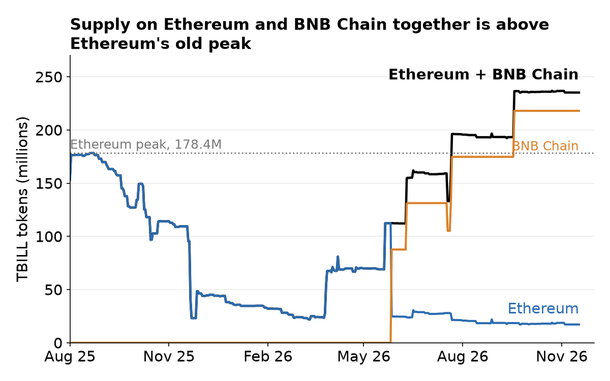
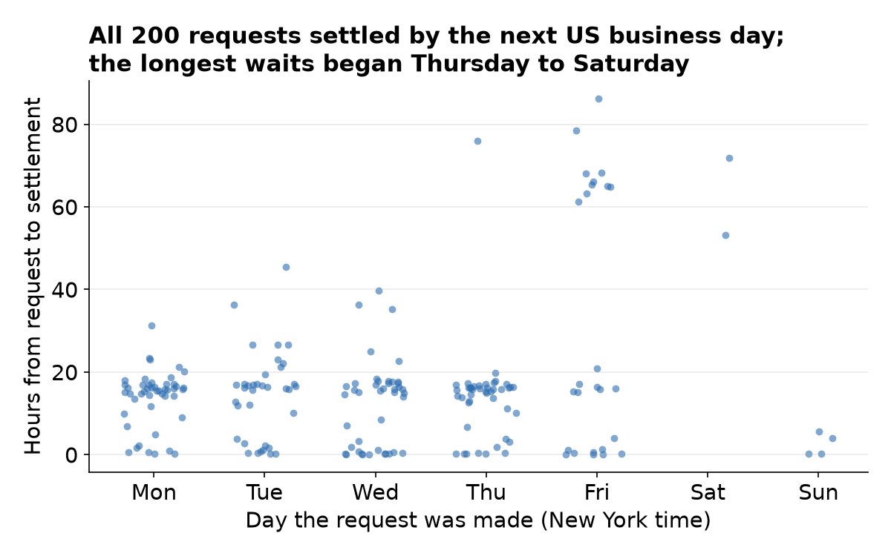
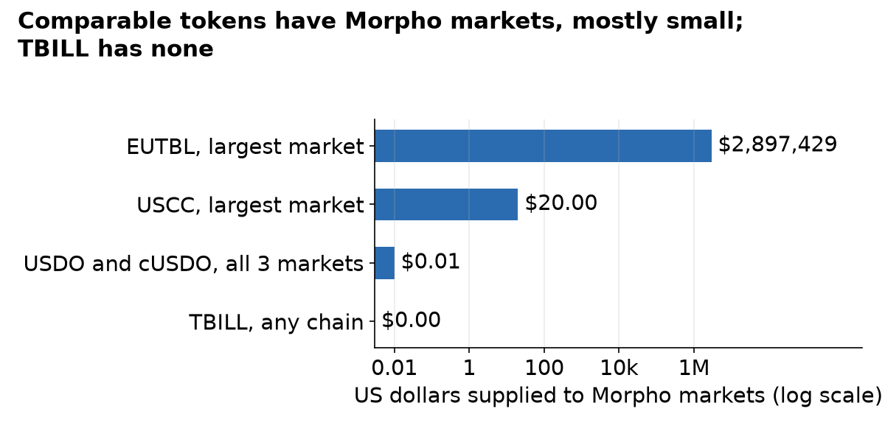

# What it would take for OpenEden's TBILL to be collateral on Morpho

On {{as_of|date}} the issuer's approved list does not include Morpho's lending contract or any of the {{liq.top_tested}} busiest Morpho liquidators I tested. The list is the first condition for a Morpho market and it is not the only one.

## Mechanism

TBILL is backed by short-dated US Treasury bills and issued by a fund registered in the British Virgin Islands. Its net asset value, posted on chain by the issuer, is {{nav.nav_now|.2f}} USDC per token. Redemptions go through a queue that an operator works in order; the documents say "Redemptions are typically processed on the next 1 U.S. business day."

Before every transfer the token contract checks that sender and receiver are on the issuer's approved list and not banned. A {{derived.admin.kyc_owner_ms}}, a wallet that needs a set number of its signers to agree, controls the list and can remove or ban any address.

A Morpho market pairs one collateral token with one loan token. Depositing, withdrawing and seizing collateral are transfers into or out of Morpho's contract, so with a permissioned token, which restricts transfers to approved addresses, Morpho and every liquidator that receives seized collateral must be on the issuer's list.

## Data

Across Ethereum and BNB Chain, supply grew from about {{chains.two_chain_first_m|.0f}} million tokens on {{chains.two_chain_first_date|date}} to about {{chains.two_chain_now_m|.0f}} million on {{as_of|date}}, above Ethereum's old peak. On Ethereum alone, supply is about {{supply.fall_vs_peak_pct|.0f}}% below its {{supply.peak_date|month}} peak. A burn of about {{chains.eth_burn_m|.0f}} million tokens on Ethereum on {{chains.burn_date|date}} matches a mint on BNB Chain to six decimals {{chains.burn_to_mint_min}} minutes later. If that is a move between chains (an inference), a little more than half of Ethereum's net fall ({{chains.burn_share_of_fall_pct|.0f}}%) is a move and the rest is holders redeeming.

*Millions of TBILL tokens at midnight UTC. The dotted line is Ethereum's peak. The XRP Ledger, with {{chains.xrpl_m|.0f}} million tokens per rwa.xyz, is not shown.*

Since {{queue.paired_from|date}}, {{queue.window_closed}} requests have left the redemption queue. The {{queue.paired_requests}} I could match to payouts followed the documents: typical wait about {{queue.latency_h_median|.0f}} hours, longest about {{queue.latency_h_max|.0f}}. The slowest requests all began {{queue.slowest6_span}}, with a weekend or a holiday in between, and counted in US business days {{queue.bd_within1_text}} by the next one. A further {{queue.unmatched_requests}} requests from December 2024 have no matched payout and {{queue.cancelled_requests}} were cancelled; the data does not show why.

*Each dot is one matched request: height is the wait, column is the weekday it was made in New York. The {{queue.unmatched_requests}} unmatched and {{queue.cancelled_requests}} cancelled requests are not shown.*

The record shows how the issuer has run the queue, not how much it could pay at once. The vault holds less than a dollar of USDC, and each of the last year's {{funding.settlement_txs_365d}} payouts followed a USDC top-up from one of {{funding.usdc_inflow_senders}} senders, most of which I cannot identify. The instant route, `redeemIns`, reverted in simulation on the redemption contract's "{{sim.sim_1000000.instant_reason}}" check, so instant capacity was not tested.

EUTBL (Spiko) and USCC (Superstate) have Morpho on their lists and have markets. The markets are small, with {{liq.eutbl_liquidations}} liquidations on EUTBL and {{liq.uscc_liquidations}} on USCC between them. The chart also shows the issuer's USDO tokens, which need no list and have three small markets.

*A log scale: each gridline is a hundred times the one before it.*

## What it would take

First, the issuer's list would have to include Morpho's contract and at least three independent liquidators; three is my judgment. This is necessary and not sufficient. A listing can be withdrawn, a liquidator's only exit is the redemption queue, which one key can pause, and there is no exchange pool.

Second, a simulated instant redemption of ${{derived.limits.cap_m|.0f}} million succeeds, or the 90th percentile wait stays within two days for three months. Without that the pilot is half the size.

If both conditions held, I would cap a pilot at about ${{derived.limits.cap_m|.0f}} million and at most 1% of the lending vault's assets, sized as a loss taken in full. If the listing were withdrawn, collateral could not be withdrawn or seized, while repaying a loan would still work. One {{derived.admin.maintainer_ms}} holds {{concentration.safe_role_slots}} role slots across the token's contracts, including the right to burn tokens from any wallet. One key can pause withdrawals.

## Not shown

Every reading is one moment. The issuer was not asked about the burn or the BNB Chain mints. On Ethereum there are {{holders.holders_excl_vault}} holders besides the vault and one holds over half, so a market there would have one or two borrowers; I found no sign of demand to borrow against the token. The cause of the small downward NAV updates last year is unexplained, and a lender's legal claim on the fund is unresearched.

Predictions are written down and scored, misses included. No hash was recorded and they entered git with the results. Of {{tally.total}} predictions, {{tally.HIT}} held, {{tally.PARTIAL}} held in part and {{tally.MISS}} did not. The most important miss was supply: predicted 25 to 150 million tokens, found about {{chains.eth_m|.0f}} million on Ethereum and about {{chains.all_m|.0f}} million across all chains, including the XRP Ledger.
